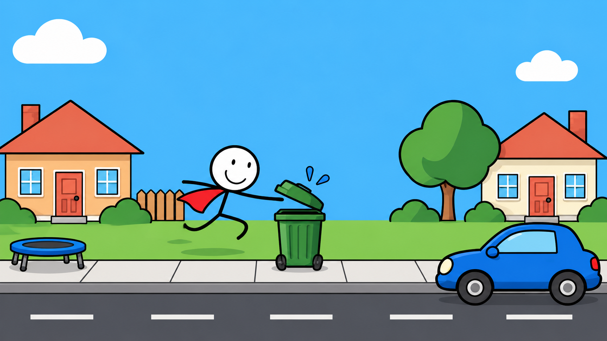
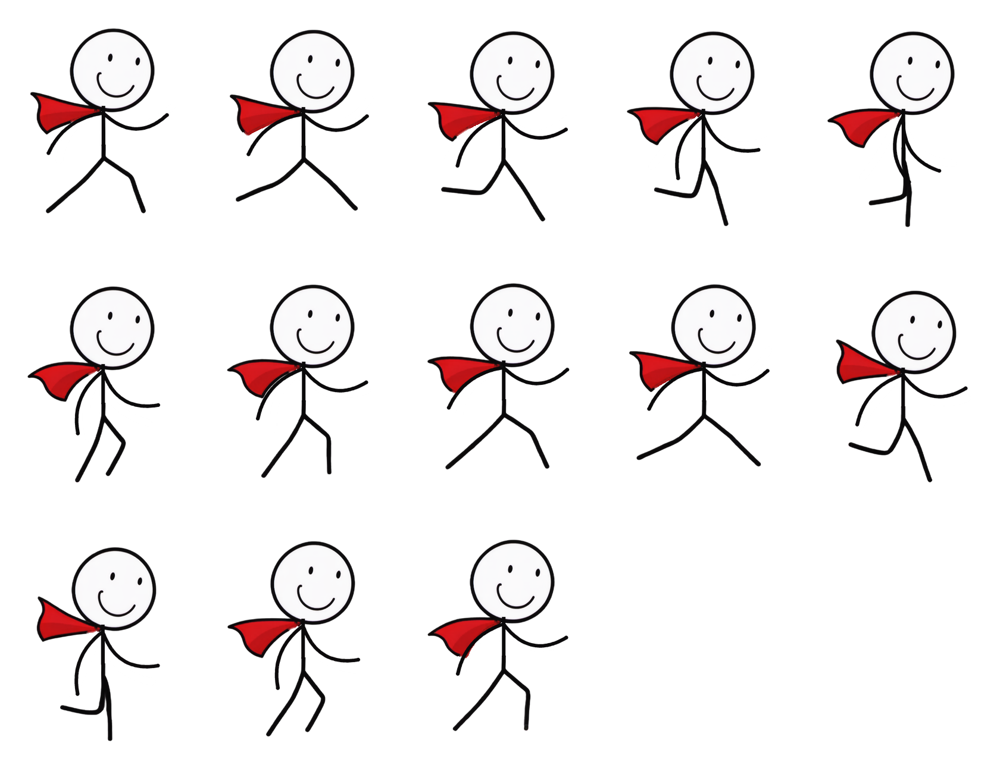

# Supa Dude — art direction

## Creative brief

A cheerful stick-figure superhero races through a sunny suburb drawn as a clean cartoon with a comic feel. Simple neighborhood shapes gain character from a few deliberate details and broad shadows. Bold ink, warm colors, open backgrounds, and playful motion unify the character, environment, Traffic, effects, and interface.

## Approved style reference

**Locked in by the user on 2026-10-17:** the second cleaner-cartoon concept, showing the MC, blue car, blue trampoline, and green Trash Can.

This image is the primary visual reference for detail level, outlines, shapes, shading, palette, and scene density. Its source is [11-water-cleaner-cel.png](concepts/2026-10-17-medium/11-water-cleaner-cel.png). Earlier detailed, minimal, and fuller-comic concepts remain exploration history; use this selected image when they disagree.

Apply this same treatment across all characters, Traffic, obstacles, backgrounds, elemental effects, and UI. Layouts, poses, and effects should adapt to gameplay while preserving the selected visual language. Selecting the concept does not change mechanics.

## Confirmed direction

- Fixed side view with one readable course plane.
- The supplied stick-figure superhero defines the MC.
- Clean, bold cartoon outlines, controlled interior detail, and a light comic vibe.
- Sunny, playful suburban setting.
- Jump, a brief airborne Flight boost, and Fire, Water, and Electricity attacks that blast obstacles.
- No Duck action or ducking pose.

The visual direction is approved. Palette codes below are starting production values rather than colors sampled from the image; match the approved image's appearance. Frame counts, export dimensions, and gameplay scale still need production tuning.

## Character reference

The approved in-game run sheet is now the only MC asset in the repo and the identity reference for new poses. The original reference image and older masters were removed on 2026-11-14 (recoverable from git commit 51c07b8).

Preserve the oversized white round head, black oval eyes, friendly curved smile, black stick limbs with rounded ends, and red cape. Use a side-facing body with a slight face turn so the expression remains visible. Head proportions, limb weight, and cape attachment stay consistent across poses.

Animate articulated poses rather than rotating the whole character in quarter-turns. The lime background belongs to the reference presentation; character exports use transparency and separate contact shadows.

## Shared drawing rules

| Element | Treatment |
| --- | --- |
| Silhouettes | Bold near-black contours, rounded joins, confident curves with slight hand-drawn variation |
| Interior detail | Thin, sparse lines for window trim, a door panel, car seams, handles, and short fence sections |
| Shapes | Rounded car bodies, three or four broad foliage lobes, gently exaggerated suburban props |
| Shading | Flat base color plus one clean shadow shape; small material highlights |
| Surface finish | Clean color fields; no hatching, halftone, paper grain, wood grain, or dense texture |
| Depth | Strongest ink on MC and interactive objects, lighter ink on nearby scenery, soft colored outlines in the distance |

Give each object a few identifying features: windows get trim and a divider, doors one inset panel and a step, cars a door seam, handle, mirror, light, and simple wheel hubs. Trees and Bushes use broad foliage shapes with a single shadow patch. Fences use a short run of plain slats. Keep glass highlights small. Avoid tire tread, individual leaves, bark marks, roof shingles, brick patterns, photorealistic surfaces, and elaborate gradients. Objects at the same distance share outline weight and lighting.

Use warm sunlight from the upper left, with short shadows down and right. Backgrounds stay lighter and less saturated than interactive objects. Avoid strong scenery edges immediately behind the MC's thin limbs.

## Proposed palette

| Role | Starting color |
| --- | --- |
| Ink | `#17191F` |
| Hero white | `#FFFDF5` |
| Cape red | `#E92736` |
| Sky blue | `#83D6F5` |
| Cream houses and UI panels | `#FFF0CB` |
| Warm sidewalk | `#D9C6A7` |
| Asphalt | `#667381` |
| Leaf green | `#65AF49` |
| Lime accent | `#A2DE38` |
| Fire orange | `#FF862B` |
| Water blue | `#248BDC` |
| Lightning yellow | `#FFD447` |

Keep the red cape prominent. Use lime in foliage highlights and branding accents. Powered Traffic retains its red/blue/yellow meanings with flame, droplet, and bolt symbols so recognition does not depend on color alone.

## Neighborhood and Traffic

Layer generous open sky, a few simple houses and trees, lawns and short fence sections, then the playable sidewalk and lower road. Layered scrolling creates depth while the camera stays side-on. Use the approved image's sparse arrangement as the density reference. Add neighborhood variety through reusable house, roof, window, door, tree, and fence modules rather than elaborate architecture or garden clutter. Mailboxes and basketball hoops can supply occasional recognizable accents.

Cars and vans have clear side profiles, rounded bodies, readable hoods and roofs, chunky tires, windows, mirrors, lights, and restrained panel detail. Roofs must remain visibly landable. Approaching Traffic moves toward the MC from the right at consistent scale; rotating wheels and small movement marks reinforce motion. Keep artwork aligned with the authoritative gameplay position.

## Obstacle vocabulary

| Asset | Identifying details and readability |
| --- | --- |
| Bush | Three or four rounded foliage lobes and one broad shadow patch |
| Trash Can | Lid, handle, rim, ribs; clear body silhouette |
| Fire Hydrant | Domed cap, side outlets, one circular fitting; distinct from a short trash can |
| Fallen Tree | Simple broken end and a few branch stubs; clearly grounded |
| Construction Pit | Simple sidewalk lip and dark opening; actual gap remains visible |
| Basketball Hoop | Backboard, rim, simplified net; interactive clearance stays obvious |
| Tree branch | Simple curved bough and broad foliage shapes; readable overhead edge |
| Flight Trampoline | Blue mat, springs, flight symbol; compression and rebound show activation |

Decorative versions stay visually subordinate to interactive objects. Existing overhead Hazards use stay-grounded timing; no art or prompt implies Duck. Art replacement must preserve collision readability and does not itself change obstacle behavior.

## Motion and powers

Use expressive limbs, quick recovery, and a cape that trails motion without covering the face or attack source. Jump poses show the arc. Brief Flight leans the hero forward with a leading arm and trailing legs; distinct activation and expiry beats communicate the temporary boost.

| Power | Shape and motion | Proposed target impact |
| --- | --- | --- |
| Fire | Rounded orange flame tongues, pale core, a few embers | Compact flare and soot puff |
| Water | Curling blue jet, white highlights, rounded droplets | Splash and tumbling trashcan lid |
| Electricity | Angular yellow bolts, dark edging, sharp sparks | Jagged pop and small fragments |

Effects show origin, target, and impact without covering the next obstacle. Prefer local bursts to full-screen flashes. Elements remain recognizable in grayscale through silhouette and motion. Impacts feel playful and exaggerated.

Apply existing target rules: Fire clears Bushes, Water clears Trash Cans, and Electricity clears Fire Hydrants. This direction does not make every obstacle or Traffic destructible. Existing Robber Battles reuse the same elemental effects and comic impact language.

## Interface

Use rounded comic panels, dark outlines, warm light fills, and one accent per action. Pair friendly display lettering for titles with sturdy, plain lettering for HUD numbers and labels. Reuse the same power symbols across Traffic, effects, HUD, and controls. Reserve impact lettering for occasional major moments.

## Production order and asset scope

Use the [Wizard Genie step-by-step prompt pack](wizard-genie-prompts.md) to generate and package the asset library, including the three-layer parallax setup.

1. Character model sheet: proportions, running, Jump, Flight, attacks, Crash reaction, and completion pose.
2. Gameplay proof scene at actual display size: reproduce the selected reference's detail level using the MC, one powered car, Trash Can, Flight Trampoline, and a house/fence section. Check Bush and Fire Hydrant variants separately to preserve the open composition. Validate outline weights and scale against the approved image.
3. Core assets: car/van variants, remaining obstacles, Jump Orb, Coin, background modules, and finish marker. Keep Jump Orbs distinct from Coins.
4. Effects and UI: three attack families, acquisition, Flight activation/expiry, landing, Crash, completion, HUD icons, panels, and controls.
5. Existing battle coverage: robbers, attack tells, hit reactions, and health indicators using the same drawing rules.

Export transparent characters, props, and effects with consistent anchors. Keep editable sources with the palette and reference. Determine dimensions and frame counts after the proof scene; the square placeholder's dimensions are not the final MC specification.

## Review criteria

- MC retains the supplied reference's identity and proportions.
- Character, cars, props, and UI look like one comic artist drew them.
- Detail level, scene density, and shading match the approved cleaner-cartoon reference.
- Houses, trees, and cars retain broad readable shapes with only a few interior features; no dense material texture is added.
- The neighborhood feels sunny and playful at gameplay speed.
- Detail survives at intended display size without visual noise.
- Traffic approach, roofs, and obstacle boundaries are easy to judge.
- Power shapes remain distinct; effects leave the next obstacle readable.
- No pose or prompt implies Duck.
- Visible contact and impact agree with gameplay geometry.

## Documentation transition

This direction replaces the square-icon appearance in the older art specification and current `CONTEXT.md` character entry. The renderer and glossary still need to adopt the stick figure during implementation; asset integration is not part of this document change.

Traffic, temporary Flight, and attacks follow ADR-0007 through ADR-0009, which already extend ADR-0006. The user has resolved ADR-0007's pending Duck preference: there is no Duck action. Robber Battle mechanics remain governed by ADR-0011.
